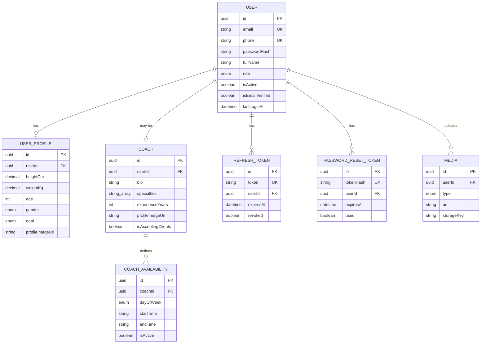

# FitNerve Backend — Phase 1 Documentation

## 1. ER Diagram

**Design notes**
- `User` is the single identity table for both regular users and coaches (`role` discriminates). A `COACH` row always owns exactly one `Coach` record (1:1) — this avoids duplicating auth/session logic per role.
- `UserProfile` and `Coach` are split from `User` so the core identity table stays lean and Phase 2/3 modules (workouts, progress, appointments) can hang off `UserProfile`/`Coach` without bloating auth queries.
- `Media` is a single generic table for all image types (`PROFILE_IMAGE`, `PROGRESS_IMAGE`, `COACH_IMAGE`) rather than one table per image type — matches "reusable CRUD" / DRY guidance in your prompt, and Phase 2's `progress_photos` can extend this later instead of forking it.
- `RefreshToken` rows are persisted (not just signed JWTs) so tokens can be revoked/rotated server-side — required for real logout and reset-password-forces-logout-everywhere behavior.

## 2. API Design — Phase 1 Endpoints

All routes are prefixed `/api/v1`. Every response uses the envelope `{ success, message, data, meta? }`; errors use `{ success: false, message, details? }`.

### Auth
| Method | Endpoint | Auth | Body | Success | Errors |
|---|---|---|---|---|---|
| POST | `/auth/register` | none | `fullName, email, phone?, password, role?` | 201, tokens + user | 400 validation, 409 email/phone exists |
| POST | `/auth/login` | none | `email, password` | 200, tokens + user | 401 invalid credentials, 403 deactivated |
| POST | `/auth/refresh` | none | `refreshToken` | 200, new token pair | 401 invalid/expired/revoked |
| POST | `/auth/logout` | none | `refreshToken` | 200 | — (idempotent) |
| POST | `/auth/forgot-password` | none | `email` | 200 (always, to prevent enumeration) | 400 validation |
| POST | `/auth/reset-password` | none | `token, newPassword` | 200 | 400 invalid/expired token |

Auth endpoints are behind a **stricter rate limiter** (10 req / 15 min by default) to blunt credential stuffing.

### Users
| Method | Endpoint | Auth | Body | Success | Errors |
|---|---|---|---|---|---|
| GET | `/users/me` | Bearer | — | 200, user + profile + coach (if any) | 401 |
| PUT | `/users/me` | Bearer | `fullName?, heightCm?, weightKg?, age?, gender?, goal?` | 200, updated profile | 400 validation, 401 |

### Coaches
| Method | Endpoint | Auth | Notes |
|---|---|---|---|
| GET | `/coaches` | none | Paginated (`page`, `limit`), filter by `specialty`, sort by `createdAt`/`experienceYears` |
| GET | `/coaches/:id` | none | Public coach profile + availability |
| GET | `/coaches/me` | Bearer, role COACH | Own profile |
| PUT | `/coaches/me` | Bearer, role COACH | `bio?, specialties?, experienceYears?, isAcceptingClients?` |
| DELETE | `/coaches/me` | Bearer, role COACH | Deletes own coach profile |
| GET | `/coaches/:coachId/availability` | none | List slots |
| POST | `/coaches/:coachId/availability` | Bearer, role COACH, owner-only | Upsert one slot (`dayOfWeek, startTime, endTime`) |

Role + ownership are both enforced: `requireRole("COACH")` gates the route, and the service layer additionally checks `coach.userId === req.user.id` so one coach can't edit another coach's slots even if they guess the `coachId`.

### Uploads
| Method | Endpoint | Auth | Notes |
|---|---|---|---|
| POST | `/uploads` | Bearer | multipart `file` + `type` (`PROFILE_IMAGE`\|`PROGRESS_IMAGE`\|`COACH_IMAGE`); 5MB limit, jpeg/png/webp/heic only |
| GET | `/uploads` | Bearer | List own media, optional `?type=` filter |
| DELETE | `/uploads/:id` | Bearer, owner-only | Deletes DB record + underlying file (local or S3) |

Full interactive spec is live at **`/api-docs`** (Swagger UI) once the server is running, generated directly from JSDoc comments in the route files — so it can never drift out of sync with the code.

## 3. Authentication Flow

1. **Register/Login** → server issues a short-lived **access token** (JWT, 15 min) and a long-lived **refresh token** (JWT, 30 days). The refresh token is also persisted in `refresh_tokens` so it can be revoked.
2. Client stores both; sends `Authorization: Bearer <accessToken>` on every protected request.
3. When the access token expires, client calls `/auth/refresh` with the refresh token → server verifies signature **and** checks the DB row isn't revoked/expired → issues a new pair and **rotates** the old refresh token (marks it revoked, links `replacedByToken`). This means a leaked, already-used refresh token is a dead end.
4. **Logout** revokes the given refresh token immediately.
5. **Reset password** revokes *all* of that user's refresh tokens, forcing re-login on every device — standard security practice after a credential change.
6. **RBAC**: `role` (`USER`/`COACH`/`ADMIN`) is embedded in the JWT and re-checked against the DB on every request (`authenticate` middleware loads the live user, not just trusting the token payload) so a deactivated account is rejected even with a still-valid token.

## 4. Frontend ↔ Backend Mapping

| Frontend screen | Backend API it will call | Current frontend state |
|---|---|---|
| (missing) Login/Register screens | `POST /auth/login`, `POST /auth/register` | **Gap** — no auth UI exists yet; navigation goes straight to `MainTabs`. Needs to be built before this API is usable end-to-end. |
| `ProfileScreen` | `GET /users/me`, `PUT /users/me`, `POST /uploads` (type=PROFILE_IMAGE) | Currently 100% hardcoded (name/weight/height in JSX) — needs to switch to fetching `GET /users/me` on mount and wiring the edit action to `PUT /users/me`. |
| `AppointmentsScreen` (coach blurb) | `GET /coaches/:id` | Currently a static block — Phase 1 backend can already power this read; booking itself (`POST /appointments`) is Phase 2. |
| `ProgressTrackerScreen` (photo boxes) | `POST /uploads` (type=PROGRESS_IMAGE), `GET /uploads?type=PROGRESS_IMAGE` | Currently static colored boxes, no picker library installed — needs `expo-image-picker` added to `package.json`. |
| Dashboard/Workouts/BMI/Calorie/Chat screens | Phase 2/3 endpoints | Out of scope for this backend delivery; will stay on mock JSON until those phases are built. |

**Loading/error state note:** none of the current screens have loading or error UI states (no spinners, no error banners) since everything is synchronous mock data. Wiring real APIs will require adding those states — flagging so it's planned for, not discovered mid-integration.

## 5. Security Architecture

- **Helmet** — sets secure HTTP headers by default.
- **CORS** — locked to `CORS_ALLOWED_ORIGINS` env allowlist (defaults open only in local dev).
- **Rate limiting** — general limiter on all `/api/v1/*`, stricter limiter on auth endpoints.
- **Validation** — every request body/query/params validated with Zod before touching a controller; unknown/malformed input never reaches business logic.
- **Password storage** — bcrypt, 12 salt rounds (configurable).
- **SQL injection** — not applicable in the traditional sense since Prisma parameterizes all queries; no raw SQL is used anywhere in Phase 1.
- **Secrets** — all via `.env`, never hardcoded; `.env` is git-ignored, `.env.example` documents required keys.
- **Refresh token rotation + revocation** — see Auth Flow above.
- **File upload safety** — MIME allowlist + 5MB cap enforced by Multer before the file ever reaches the storage layer.

## 6. Validation Strategy

Zod schemas per module (`src/validators/*.js`), applied via a single `validate()` middleware that checks `body`/`query`/`params` and returns a uniform `400` with a `details` array of `{ field, message }` — so the frontend can map errors directly to form fields without string-parsing messages.

## 7. Logging Strategy

Winston, npm log levels. Dev: colorized console. Prod: structured JSON (ready to ship to CloudWatch/Datadog/ELK). `morgan` feeds HTTP access logs into Winston so request logs and application logs live in one place. Errors ≥500 are logged at `error` level with stack traces; expected 4xx errors are logged at `warn` without stack noise.

## 8. Development Roadmap (Phase 1 → handoff)

1. ✅ Schema, migrations-ready Prisma models
2. ✅ Auth module (register/login/refresh/logout/forgot/reset)
3. ✅ User profile module
4. ✅ Coach CRUD + availability
5. ✅ Upload module (local-disk now, S3 by flipping one env var)
6. ✅ Infra: logging, validation, error handling, security headers, rate limiting, Swagger, Postman
7. ⬜ **You provision a real PostgreSQL instance** and run `npm run prisma:migrate` (sandbox network here can't reach Prisma's binary CDN — see Section 10)
8. ⬜ Frontend team builds Login/Register screens and wires `ProfileScreen`/uploads to these live endpoints
9. ⬜ Phase 2 kickoff: BMI, Calorie, Activity, Workouts, Progress, Appointments

## 9. Testing Checklist (run once you have a live Postgres instance)

- [ ] `npm run prisma:migrate` creates all 6 tables without error
- [ ] `POST /auth/register` → 201, returns tokens; duplicate email → 409
- [ ] `POST /auth/login` with wrong password → 401
- [ ] `GET /users/me` without token → 401; with token → 200
- [ ] `PUT /users/me` with invalid `age` (e.g. 5) → 400 with field detail
- [ ] `POST /auth/refresh` with a revoked token → 401
- [ ] Register a `COACH` role → `GET /coaches/me` returns their auto-created coach row
- [ ] `POST /coaches/:coachId/availability` as a *different* coach → 403
- [ ] `POST /uploads` with a `.txt` file → 400; with a `.jpg` → 201 and file appears in `uploads/profile/`
- [ ] `/api-docs` loads and every route is documented
- [ ] Import `postman/FitNerve-Phase1.postman_collection.json`, run Register → Login → Get Profile chain end-to-end

## 10. Final Review Report

**What was verified in this sandbox:**
- Every source file passes `node --check` (no syntax errors) — all 30 backend files.
- `npm install` completes cleanly; `multer` upgraded from 1.x → 2.x (1.x has published CVEs) with no code changes needed for the APIs used here.
- Postman collection is valid JSON.
- Route → controller → service → repository → Prisma wiring was manually traced for every endpoint.

**What could not be verified here, and why:**
- `npx prisma generate` / `migrate` fail in this sandbox because Prisma downloads its query engine binary from `binaries.prisma.sh`, which isn't on this environment's network allowlist (only npm/GitHub/PyPI domains are reachable here). This is a sandbox restriction, not a code defect. Run `npm run prisma:generate` and `npm run prisma:migrate` on your own machine/CI (with normal internet access and a real `DATABASE_URL`) as the first setup step — see README.
- No live database means the auth/CRUD flows above are traced by code review, not executed. Run the Testing Checklist above once Postgres is connected.

**Known Phase 1 gaps to plan for (not backend defects — frontend/process items):**
- No Login/Register UI in the current frontend build.
- No image-picker library installed in the frontend for real upload flows.
- Email delivery for password reset is stubbed to a log line (`authService.forgotPassword`) — swap in SES/SendGrid when ready; the function boundary is already isolated for that.
