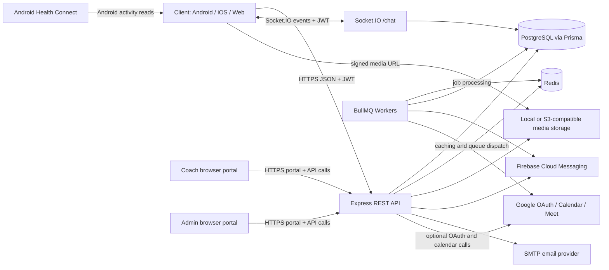
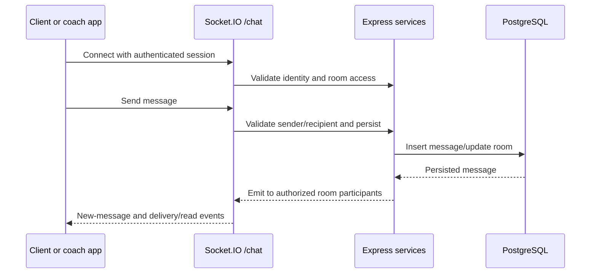

# FitNerve System Design and Architecture

**Checked:** 2026-11-17
**Scope:** Current source tree in `BACKEND/` and `FRONTEND/`, plus workspace deployment/configuration files.

This document describes the architecture that exists in this checkout. It distinguishes source-backed behavior from deployment assumptions and known gaps; it is not a certification of a live production environment.

## 1. Product overview

FitNerve is a coach-supported fitness platform. Clients use a cross-platform mobile/web app to track activity and progress, follow workouts, book coach sessions, communicate with their coach, and manage their account. Coaches use a browser portal to manage availability, clients, sessions, messages, and workout assignments. Administrators use a separate browser portal for platform operations and content/data management.

The workspace contains two separate Git projects:

- `FRONTEND/`: Expo + React Native app for Android, iOS, and web (React Native Web).
- `BACKEND/`: Node.js + Express API, Prisma/PostgreSQL data layer, Socket.IO server, Redis-backed caching and BullMQ background job processing, and static admin/coach portals.

The portals are served by the backend; they are not part of the React Native app. The root Compose file runs a backend and a static web build; PostgreSQL is an optional Compose profile, so deployments may use a separately managed database.

## 2. System context



### Runtime boundaries

| Component | Responsibility | Primary interface |
|---|---|---|
| Expo application | Client and coach-facing app screens; local navigation/state; device integrations | REST `/api/v1`, Socket.IO, Android Health Connect |
| Express backend | Authentication, authorization, domain logic, API, uploads, admin and coach portal hosting | `/api/v1/*`, `/admin`, `/coach`, `/api-docs` |
| PostgreSQL | Persistent application and privacy data | Prisma models/migrations |
| Redis | Shared in-memory data store for HTTP response caching and BullMQ job queues | Redis protocol / port `6379` via `ioredis` |
| BullMQ Workers | Background asynchronous execution for push notifications and appointment booking tasks | Redis queue consumers (`notifications`, `bookings`) |
| Socket.IO | Authenticated real-time chat, presence, typing and delivery/read events | `/chat` namespace |
| Object/file storage | Uploaded images and other media | Backend-managed uploads and short-lived signed URLs |
| External services | Email, push, Google Calendar/Meet and optional AI/provider integrations | Provider APIs, configured per environment |

## 3. Technology stack

### Mobile and web client

- Expo SDK 53, React Native 0.79, React 19, TypeScript.
- React Native Web for the browser build; one shared navigation/screen codebase.
- React Navigation native stack and bottom tabs.
- NativeWind/Tailwind styling and shared React Native components.
- Zustand for client state; `socket.io-client` for real-time chat.
- Expo Secure Store, Image Picker/Image Manipulator, Video, Web Browser and related Expo modules.
- `react-native-health-connect` for Android Health Connect. This source inspection did not find an equivalent Apple HealthKit integration; do not assume iOS health-data parity.
- Android application ID and iOS bundle ID: `com.fitnerve.app` (from Expo config).

### Backend

- Node.js 26 LTS (package engine `>=26.0.0`) and **Express 4**. The implementation is not Fastify.
- PostgreSQL, Prisma ORM 5.22, checked-in schema and migrations.
- Redis 7 via `ioredis` for multi-instance distributed HTTP response caching and key-value storage.
- BullMQ for distributed background task queues (`notifications` and `bookings` queues) with Redis backend.
- REST JSON API under `/api/v1`, with Swagger/OpenAPI UI at `/api-docs`.
- JWT access and refresh tokens, bcrypt password hashing, OTP flows, Express rate limiting, Helmet, CORS, Zod validation, Winston logging.
- Socket.IO 4 for chat and related live events.
- Firebase Admin SDK for Firebase Cloud Messaging (push). Push dispatch is handled asynchronously by BullMQ workers.
- Nodemailer/SMTP for OTP and account email; Google APIs for optional Calendar/Meet workflows; node-cron for scheduled reminder sweeps.
- AWS SDK v2-compatible S3 client for optional S3-compatible storage; local disk storage is also supported.

### Caching strategy

FitNerve uses a Redis-backed caching layer (`src/middlewares/cache.middleware.js` and `src/config/cache.js`) replacing single-process in-memory caches. This supports horizontal scaling across multiple container instances:

- **Cached endpoints:**
  - Coach directory (`GET /api/v1/coaches`, `GET /api/v1/coaches/:id`, `GET /api/v1/coaches/:id/availability`) — TTL 60s
  - Published content categories and posts (`GET /api/v1/content/categories`, `GET /api/v1/content/posts`) — TTL 60s–300s
  - Workout plans and exercise library (`GET /api/v1/workouts`, `GET /api/v1/workouts/exercises`, `GET /api/v1/workouts/:id`) — TTL 60s
- **Cache key structure:** `http:{originalUrl}` (e.g. `http:/api/v1/coaches?page=1&limit=20`)
- **Invalidation:** Non-blocking `SCAN`-based invalidation (`cacheDel('http:/api/v1/coaches*')`) triggered immediately on mutation routes (POST/PUT/DELETE) to prevent stale reads.

### Background job processing (BullMQ)

Asynchronous workflows are handled via BullMQ (`src/config/queue.js`, `src/queues/*`):

- **`notifications` queue:**
  - Priority-based push dispatch to Firebase Cloud Messaging (FCM). System alerts run at priority 1; coaching/promotional messages run at priority 3.
  - Concurrency: 10 parallel workers.
  - Automatic pruning of invalid FCM tokens.
- **`bookings` queue:**
  - Post-booking side effects (Google Meet generation, activity feed records, welcome chat messages) processed off the critical HTTP request path.
  - Scheduled appointment reminders (`APPOINTMENT_REMINDER`) delayed to trigger prior to session start times.
  - Concurrency: 5 parallel workers.
- **Resilience:**
  - Exponential backoff retry policy (default 3 attempts, configurable).
  - Graceful shutdown: workers drain active jobs before closing Redis connections on SIGTERM/SIGINT.
  - Automatic fallback: if Redis or the queue is unavailable, notification and booking flows fall back to direct execution.

### Data, admin and operations

- PostgreSQL is the system of record; Prisma schema maps application data to `public` and privacy data to `privacy` schemas.
- Admin and coach portals are static HTML/JavaScript applications in `BACKEND/admin/` and `BACKEND/coach/`, served by Express.
- Docker Compose is available at workspace root. The Compose Postgres service is under profile `local-db`; it is not enabled by default.
- Web export is a static Expo web bundle (`expo export -p web`). Android builds use Expo/EAS; actual signing and store release require separate credentials and release workflow.

## 4. Application navigation and capabilities

The screen inventory below is derived from `FRONTEND/src/screens/` and the existing navigation registry. Presence of a screen does not by itself verify every provider-backed flow end-to-end.

### Client application

- **Entry and identity:** splash, onboarding, registration, login, OTP verification, forgot password, reset password.
- **Fitness dashboard:** dashboard, BMI calculator, calorie calculator, activity/steps, activity feed, progress tracker, transformation photo history and session detail.
- **Training:** workout library, workout details, custom workout creation/details, workout assignment.
- **Coaching:** coach directory, coach details/profile, booking, appointments, schedule session, Google Calendar preview.
- **Engagement:** chat, notifications, content library/content details, help center.
- **Account:** profile, edit profile, packages/payment methods, privacy.

### Coach portal and coach flows

Coach portal screens cover dashboard, profile, availability, appointments, assigned clients, workout assignments and messages. Coaches can manage the clients and records authorized to their role; head-coach behavior is implemented in backend services. The coach portal is browser-based and is served from `/coach`.

### Admin portal

Admin portal modules include dashboard, user and coach management, payments, audit logs, support requests, coach reports, chat rooms, workout plans/exercises, content and database-table exploration, media-storage diagnostics, and privacy administration. It is served from `/admin`.

### System and failure states

The codebase includes API health reporting and client-side loading, empty, retry/error and expired-session handling in relevant flows. Permission handling exists for Android Health Connect. A global maintenance-mode or forced-update service/screen, full offline mode, and production provider failure behavior are not established solely by the presence of these local states; verify them in each deployed target.

## 5. Backend organization and API domains

Backend source follows a layered layout:

```text
BACKEND/src/
  config/       environment, logger, Firebase, Swagger, Redis, BullMQ
  controllers/  HTTP request/response handling
  services/     domain rules and orchestration
  repositories/ Prisma data access
  routes/v1/    versioned Express routers
  middlewares/  authentication, validation, rate limits, uploads, errors, cache
  validators/   Zod schemas
  sockets/      Socket.IO gateways
  jobs/         scheduled cron sweeps
  queues/       BullMQ queues & workers (notifications, bookings)
BACKEND/prisma/
  schema.prisma
  migrations/
BACKEND/admin/  admin portal
BACKEND/coach/  coach portal
```

Registered API domains include:

| Domain | Route prefix (under `/api/v1`) | Main responsibilities |
|---|---|---|
| Authentication | `/auth` | Registration, OTP, login, token refresh, password recovery |
| Users/coaches | `/users`, `/coaches` | Profiles, coach directory, client/coach relationships |
| Fitness metrics | `/bmi`, `/calorie`, `/steps`, `/activity`, `/progress` | Metrics and progress history |
| Training | `/workouts`, `/custom-workouts`, `/workout-assignments` | Library, custom plans, assigned plans, completions |
| Appointments/calendar | `/appointments`, `/calendar` | Availability, booking, cancellation/rescheduling, calendar aggregation and optional Google connection |
| Notifications | `/notifications`, `/device-tokens` | In-app notifications, preferences and device registration |
| Communication | `/chat` | Messages, chat operations and AI coach endpoint |
| Content | `/content` | Content categories and posts |
| Platform operations | `/admin`, `/admin/analytics` | Administrative operations and dashboard analytics |
| Commerce | `/packages` | Membership package and payment-related records |
| Support and trust | `/favorites`, `/coach-reports`, `/support` | Favourites, coach reports and support tickets |
| Integrations | `/integrations` | External integration endpoints, including meeting-link workflows |
| Privacy | `/privacy`, `/admin/privacy` | User privacy requests/consents/export and admin privacy operations |
| Health | `/health` | API liveness response |

All API route modules are mounted from `src/routes/v1/index.js`. Authentication and role checks are applied through middleware and route/service authorization. Sensitive ownership checks should use the authenticated principal rather than client-supplied user identifiers; route-by-route authorization still needs a security review before release.

## 6. Authentication and request flows

### REST authentication

1. A client submits credentials or begins registration/password-recovery through `/api/v1/auth`.
2. OTP delivery uses configured SMTP when enabled; OTP codes and attempts are managed by the backend.
3. Successful authentication issues short-lived access and longer-lived refresh tokens. Passwords are stored as bcrypt hashes; refresh sessions are persisted in PostgreSQL.
4. The app stores credentials using platform secure storage where supported and sends the access token to protected REST routes.
5. Backend middleware validates the token and role, then handlers enforce resource ownership and domain rules.

### Chat



REST chat endpoints provide a fallback/history path. Socket authentication, cross-origin proxying, reconnection and delivery behavior must be verified in the target hosting environment, especially behind reverse proxies.

## 7. Data architecture

The canonical schema is `BACKEND/prisma/schema.prisma`; the model inventory below is grouped by responsibility. Exact columns, relations and indexes should be read from the schema rather than inferred from these summaries.

### Core application data (`public` schema)

| Data group | Models/tables | Purpose |
|---|---|---|
| Identity and access | `User`, `RefreshToken`, `OtpCode`, `UserProfile` | Accounts, sessions, verification/recovery codes and profile/fitness attributes |
| Coaching | `Coach`, `CoachAvailability`, `FavoriteCoach` | Coach profile, booking availability and client favourites |
| Scheduling | `Appointment`, `GoogleCalendarConnection` | Coach/client sessions, meeting metadata and encrypted Google integration tokens |
| Media and progress photos | `Media`, `ProgressPhotoSetLock` | Uploaded media metadata and progress-photo set timing/locking |
| Health and progress | `BmiLog`, `CalorieLog`, `StepLog`, `ActivityLog`, `WeightLog`, `BodyMeasurement` | Fitness measurements and activity history |
| Workout library and completion | `Exercise`, `WorkoutPlan`, `WorkoutPlanExercise`, `WorkoutCompletion`, `ScheduledWorkout` | Catalogue, plan composition, completion and schedules |
| Custom/assigned workouts | `CustomWorkout`, `CustomWorkoutCompletion`, `CustomWorkoutExercise`, `AssignedWorkoutPlan` | Coach-created plans, exercises, assignment and completion tracking |
| Billing | `Package`, `Payment` | Package catalogue and payment attempts/status (no payment gateway success should be assumed from the data model) |
| Messaging and alerts | `ChatRoom`, `ChatMessage`, `Notification`, `DeviceToken`, `NotificationPreference` | Conversation history, push registration, in-app notifications and preferences |
| Content | `ContentCategory`, `ContentPost` | Managed educational/training content |
| Support and audit | `CoachReport`, `SupportTicket`, `AdminAuditLog`, `PlatformIntegration` | Reports, support workflow, administrative audit events and integration configuration |

### Privacy data (`privacy` schema)

`PrivacyNotice`, `PrivacyNoticeAcknowledgement`, `PrivacyPurpose`, `PrivacyConsentRecord`, `PrivacyConsentWithdrawal`, `PrivacyRequest`, `PrivacyGrievance`, `PrivacyNominee`, `PrivacyProcessor`, `PrivacyRetentionPolicy`, `PrivacyRetentionRun`, `PrivacyAuditLog`, and `PrivacyBreachIncident` support notice acknowledgement, consent history, privacy requests, grievances, nominee records, processor inventory, retention reporting, privacy audit events and incident records.

### Data lifecycle and media

- Structured records live in PostgreSQL. Files are stored on local disk or an S3-compatible service selected by environment configuration.
- Database rows hold media metadata/references; clients obtain backend-mediated or short-lived signed access URLs rather than permanent public bucket URLs.
- Backups, encryption at rest, key rotation, object lifecycle, regional residency and restore procedures depend on the chosen provider/deployment and are not verified by source inspection.
- Account deletion, full retention enforcement and cleanup of every external-provider artifact are documented as incomplete; see section 11.

## 8. Integrations and data sources

| Integration | Purpose | Current boundary/qualification |
|---|---|---|
| Android Health Connect | Read steps, active calories and exercise records | Native Android only; users grant OS-level permissions. No iOS HealthKit equivalent was located in the inspected source. Browser support is not implied. |
| Firebase Cloud Messaging | Push notifications | Firebase Admin is server-side sender; requires service-account configuration and registered device tokens. This is not Firebase Authentication. |
| SMTP via Nodemailer | OTP and account emails | Requires provider credentials and successful outbound mail connectivity. |
| Google OAuth/Calendar/Meet | Optional calendar connection and meeting-link generation | OAuth tokens are documented as encrypted at rest; OAuth console clients, consent state, redirect URIs and production behavior require environment verification. Calendar sync is described as read-only. |
| S3-compatible storage | Durable uploaded media | Optional; local storage is also supported. Ephemeral hosting filesystems require external persistent storage. |
| AI coach provider | AI-generated coach response | Endpoint is registered; provider key/configuration and production guardrails are environment dependent. |
| Payment gateway | Payment capture/settlement | Package/payment records exist; backend README states payments remain `PENDING` until a gateway is added. Do not represent checkout as live payment processing without gateway evidence. |

## 9. Privacy and DPDP implementation status

Privacy routes and a dedicated Prisma `privacy` schema are present. The existing `PRODUCTION_SCREEN_AUDIT.md` records these implementation boundaries:

- Versioned notice retrieval and registration acknowledgement exist; notice content, purposes and legal basis require product/legal approval.
- Consent history/withdrawal and owner-scoped JSON/CSV export are implemented in code, with scope and third-party data boundaries still requiring review.
- Correction and deletion requests can be submitted/tracked, but correction execution is manual and end-to-end deletion is **not implemented**.
- Grievance intake/admin review exists; response SLAs/escalation and delivery evidence are not automated.
- Nominees can be recorded but are not identity/authority verified.
- Retention supports policy records and dry-run reporting only; no verified enforcement scheduler/executor is described.
- Breach incident records support administrative tracking; automated affected-person/Board notification, deadlines and delivery receipts are not implemented.
- Processor entries are marked `REVIEW_REQUIRED`; operational/legal evidence must be supplied.
- Child/guardian safeguards and eligibility policy are not verified.
- The existing audit says the DPDP migration was not applied during that audit. Current database migration state is **not verified by this document**.

These are implementation observations, not legal advice or a claim of DPDP Act/Rules compliance. Do not run the migration against production without the separately approved deployment and migration process.

## 10. Deployment and environment configuration

### Local development

- Root `docker-compose.yml` maps backend to port `5050`, frontend web to `3000`, and Redis to `6379`; configure the frontend API base URL for the actual reachable backend.
- The Compose PostgreSQL service is optional under `local-db` profile. Without that profile, the backend must connect to another PostgreSQL instance via `DATABASE_URL`.
- Redis runs automatically on port `6379` using `redis:7-alpine` with `noeviction` policy (recommended for BullMQ queue safety) and AOF persistence enabled.
- Backend README documents a default development port of `4000`; Compose overrides it to `5050`. Treat the port as environment-configured, not fixed.
- Frontend `EXPO_PUBLIC_*` settings are bundled at build/start time. A mobile device cannot reach a backend through its own `localhost`; use a reachable LAN or deployed URL.

### Production shape

- Run the Express/Socket.IO API as a persistent Node process (not a serverless-only function), behind HTTPS and a WebSocket-capable reverse proxy.
- Use managed PostgreSQL or a separately operated PostgreSQL cluster; restrict network access to the backend and migration process.
- Provision a Redis 7 instance or cluster for shared caching and BullMQ job management; ensure persistence and connection pooling are configured.
- Use durable object storage if instances have ephemeral disks.
- Serve the Expo web export from a static host/CDN, or use an equivalent supported static deployment. Ensure browser origin is allowed by API CORS configuration.
- Admin/coach portals are served by the API origin unless intentionally split; secure admin access and protect portal/API origins with TLS and operational controls.
- The root `render.yaml` exists, but its compatibility with the case-sensitive `BACKEND/` directory and the current monorepo layout was not validated. Treat it as a configuration candidate, not proof of a working deployment.

### Configuration categories

Configure secrets through the deployment secret manager; do not commit values. Relevant names include:

- Core: `DATABASE_URL`, `REDIS_URL`, `PORT`, `NODE_ENV`, `CORS_ALLOWED_ORIGINS`.
- Job Queue: `BULLMQ_DEFAULT_ATTEMPTS`, `BULLMQ_BACKOFF_DELAY`.
- Authentication: `JWT_ACCESS_SECRET`, `JWT_REFRESH_SECRET`, expiry values, OTP policy values.
- Email/push: `SMTP_*`, `EMAIL_FROM`, `FCM_SERVICE_ACCOUNT_BASE64`.
- Media: `STORAGE_DRIVER`, S3 endpoint/bucket/region/credentials.
- Google integration: `GOOGLE_*` OAuth client and encryption configuration.
- Background jobs: `ENABLE_CRON`, `REMINDER_SWEEP_CRON`.
- Frontend build: `EXPO_PUBLIC_API_BASE_URL` and any documented public OAuth client identifiers.

Never place server secrets in `EXPO_PUBLIC_*`; those values are embedded in the client bundle. Disable OTP bypass mechanisms in real deployments. Exact required/default values are maintained in `BACKEND/src/config/env.js` and `.env.example`.

## 11. Known limitations and release checks

The source and documentation inspected do not establish a fully production-verified system. The following remain material:

1. **Privacy operations:** complete verified account deletion, retention enforcement, nominee verification, breach notification delivery, child/guardian policy, processor/legal review and migration rollout evidence.
2. **Mobile parity:** iOS HealthKit support was not found; Android Health Connect needs a real-device permission/sync check. Signed release builds and store reviews are separate steps.
3. **External providers:** validate SMTP delivery, FCM on-device delivery, Google OAuth/Calendar/Meet, persistent media storage, and AI provider behavior with production-like credentials and callback domains.
4. **Payments:** no live payment gateway was established; payment records remaining pending are not proof of settlement.
5. **Operations:** verify TLS, secrets, production CORS, WebSocket proxy upgrade/timeouts, rate limits, logs/alerts, backup restore, migration rollback/recovery, health checks and disaster recovery.
6. **End-to-end quality:** source-level screens, lint, type checking or bundling do not prove working browser/device flows. Run role-based end-to-end journeys on staging, including network loss, session expiry, authorization failures, permissions, uploads, chat reconnects and notification delivery.
7. **Deployment manifest:** validate Render/root Compose settings against the intended directory, ports, health checks, database, storage and release process before use.
8. **Redis infrastructure and queue monitoring:** Redis 7 is required for distributed HTTP caching and BullMQ background workers. Ensure Redis memory limits (`maxmemory`), eviction policies (`allkeys-lru`), persistent storage, and connection health are actively monitored in production environments.

Production readiness should be assessed independently for Android, iOS, web, backend, admin/coach portals and privacy operations. The existing screen audit contains the latest checked findings and must be updated after validation.

## 12. Key source references

- `BACKEND/src/routes/v1/index.js` — API route registration.
- `BACKEND/src/config/env.js` — runtime configuration names/defaults and required settings.
- `BACKEND/src/server.js` — HTTP server, Socket.IO and startup wiring.
- `BACKEND/prisma/schema.prisma` — application and privacy data models.
- `BACKEND/docs/DATABASE_TABLES.md` — table-oriented reference.
- `BACKEND/docs/DPDP_API_REFERENCE.md`, `DPDP_DATABASE_SCHEMA.md`, `DPDP_IMPLEMENTATION.md`, `DPDP_DEPLOYMENT.md` — privacy implementation references.
- `BACKEND/docs/PRODUCTION_SCREEN_AUDIT.md` — screen inventory, audit findings and validation limitations.
- `BACKEND/admin/admin.html`, `BACKEND/coach/coach.html` — portal applications.
- `FRONTEND/src/navigation/AppNavigator.tsx` — mobile/web navigation registry.
- `FRONTEND/src/screens/` — app screens.
- `FRONTEND/app.json` — Expo, platform identifiers, permissions and native plugins.
- `BACKEND/package.json`, `FRONTEND/package.json` — direct dependency and script inventories.
- Workspace `docker-compose.yml`, `render.yaml` — deployment configuration candidates.

## 13. Evidence and accuracy notes

This document was assembled by inspecting source and checked-in documentation on the date above. Runtime production services, live database migration state, external provider accounts, real device behavior, deployed domains and deployment secrets were not accessed or verified. Where behavior depends on those systems, this document explicitly describes the dependency rather than asserting a verified outcome.
